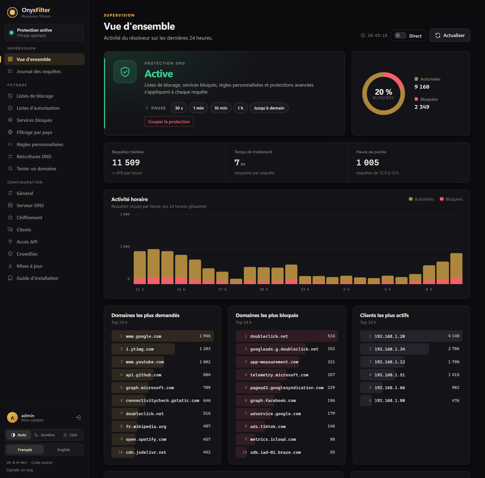
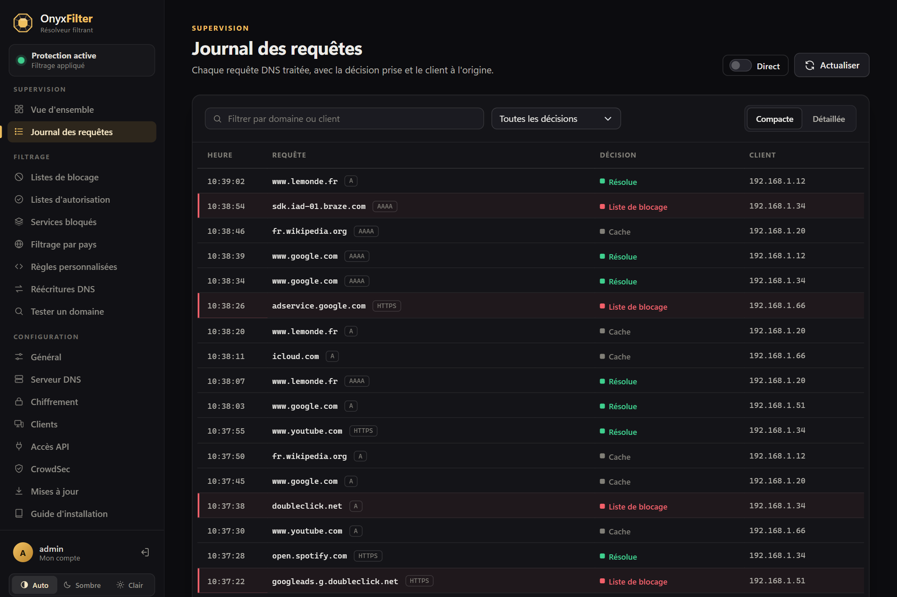
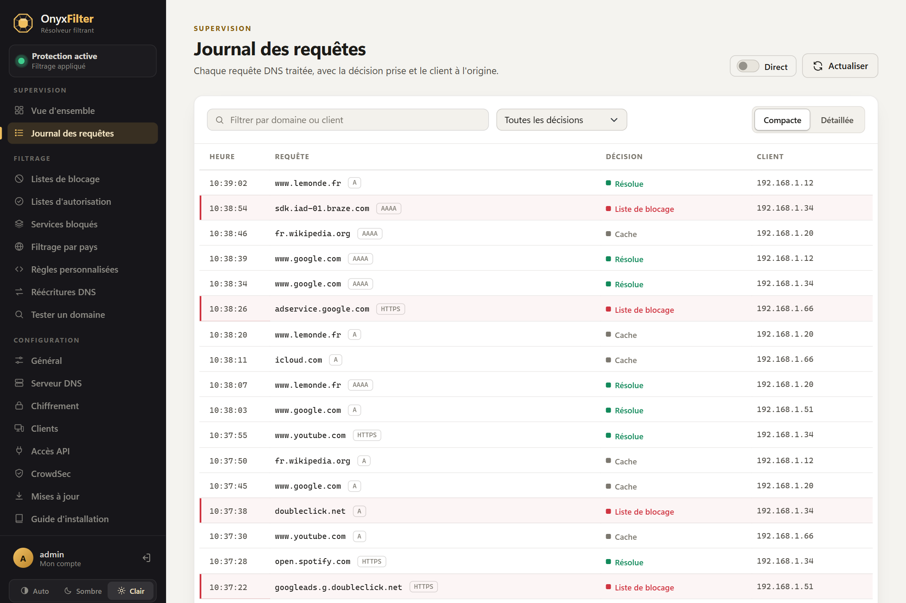
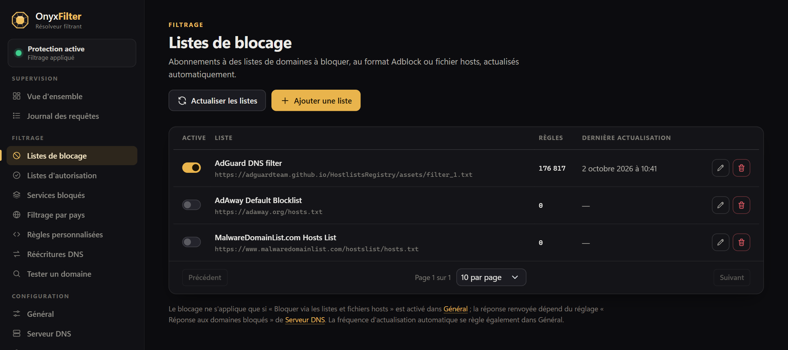
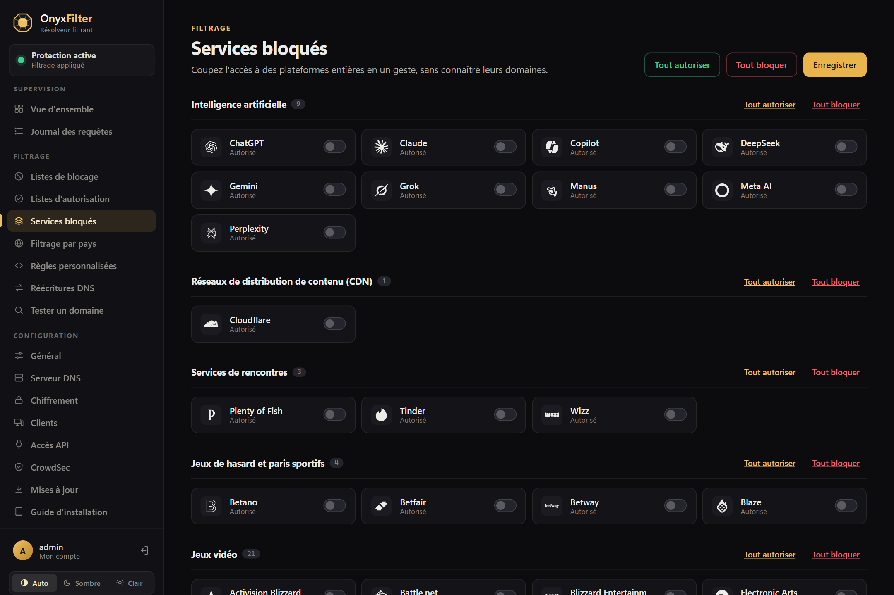
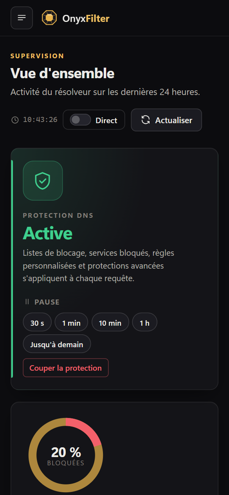

# OnyxFilter

*[Version française](README.md) · [English version](README.en.md) · Deutsche Version*

Selbstgehosteter filternder DNS-Resolver: Er blockiert Werbung, Tracker und unerwünschte Domains für alle Geräte im
Netzwerk, mit einer Web-Administrationsoberfläche, einer Automatisierungs-API und einem Kommandozeilenwerkzeug, alles
in einer einzigen Binärdatei.

Geschrieben in C# (.NET 10, ASP.NET Core Blazor), ausgelegt für den Betrieb auf einem kleinen Rechner (2 GB RAM
genügen).

## Vorschau



| Anfrageprotokoll                                    | Helles Design                                                              |
|-----------------------------------------------------|----------------------------------------------------------------------------|
|  |  |
| **Sperrlisten**                                     | **Blockierte Dienste**                                                     |
|      |                |

<p align="center"></p>

<sub>Aufnahmen einer Demo-Instanz (simulierter Datenverkehr).</sub>

## Funktionen

- **DNS-Server** über UDP/TCP (Port 53) sowie verschlüsseltes DNS: DNS-over-HTTPS, DNS-over-TLS und DNS-over-QUIC
  (Letzteres benötigt unter Linux das Paket `libmsquic`).
- **Filterung**: Sperr- und Erlaubnislisten (Adblock- oder Hosts-Format, automatisch aktualisiert), eigene Regeln
  (einschließlich regulärer Ausdrücke), DNS-Umschreibungen, Blockieren beliebter Dienste per Klick mit planbarer
  Pause.
- **Schutzfunktionen**: sicheres Surfen (Schadsoftware, Phishing), Jugendschutz, erzwungene sichere Suche, global
  oder pro Client.
- **Upstream-Server**: UDP, TCP, DNS-over-TLS und DNS-over-HTTPS, mit Lastverteilung, parallel oder nach schnellster
  Antwort, mit Fallback- und Bootstrap-Servern, Cache und Ratenbegrenzung.
- **Überwachung**: Übersicht (stündliche Aktivität, Blockierrate, Ranglisten), filterbares Anfrageprotokoll,
  vorübergehendes Aussetzen des Schutzes.
- **Administration**: Weboberfläche auf Französisch, Englisch, Deutsch, Spanisch und Italienisch (helles und dunkles
  Design, mobil), Anmeldung per Passwort oder Passkey, HTTP-API mit Token, Kommandozeilenbefehle.
- **Updates** per Klick aus der Oberfläche, auf Basis der GitHub-Releases.

## Installation (Linux x64)

Voraussetzungen: Linux x64 mit systemd. Die veröffentlichte Version ist eigenständig (sie enthält die
.NET-Laufzeitumgebung): Es muss nichts weiter installiert werden.

```sh
curl -fsSL https://github.com/AnthoDingo/OnyxFilter/releases/latest/download/install.sh | sudo bash
```

Das Skript lädt das neueste Release herunter, prüft dessen SHA-256-Prüfsumme, installiert es unter `/opt/onyxfilter`
mit einem eigenen Systemkonto `onyxfilter` und aktiviert anschließend den Dienst `onyxfilter`.
Optionen: `--version 1.4.0`, `--port 8080` (Weboberfläche), `--dir /opt/onyxfilter`. Erneut auf einer bestehenden
Installation ausgeführt, aktualisiert es diese und behält dabei Daten und Einstellungen bei.

### Erster Start

Die Oberfläche ist unter `http://<server-adresse>:8080` erreichbar. Beim ersten Start wird ein Konto `admin` mit
einem zufälligen Passwort angelegt, das im Dienstprotokoll ausgegeben wird:

```sh
sudo journalctl -u onyxfilter | grep -A3 'Compte administrateur'
```

Ändern Sie es anschließend unter **Mein Konto** oder über die Kommandozeile (siehe unten). Passwort vergessen oder
nicht im Protokoll zu finden: Legen Sie ein neues fest mit
`sudo -u onyxfilter /opt/onyxfilter/OnyxFilter user:reset-password admin`. Zuletzt tragen Sie die Adresse des Servers
als DNS-Server in den DHCP-Einstellungen Ihres Routers ein.

### Port 53 bereits belegt

Auf vielen Distributionen belegt `systemd-resolved` bereits Port 53. Deaktivieren Sie dessen lokalen Stub-Listener:

```sh
# /etc/systemd/resolved.conf
[Resolve]
DNSStubListener=no
```

dann `sudo systemctl restart systemd-resolved && sudo systemctl restart onyxfilter`.

### Docker

Ein Multi-Arch-Image (linux/amd64, linux/arm64: Raspberry Pi 3+ mit 64-Bit-System) wird mit jeder Version unter
`ghcr.io/anthodingo/onyxfilter` veröffentlicht (`latest`, `1`, `1.4`, `1.4.0`…). Die Vorlage
[`docker-compose.yml`](docker-compose.yml) gibt DNS (53) und die Oberfläche (8080) frei und speichert die Daten in
einem Volume:

```sh
curl -fsSLO https://raw.githubusercontent.com/AnthoDingo/OnyxFilter/main/docker-compose.yml
docker compose up -d
docker compose logs onyxfilter | grep -A3 'Compte administrateur'
docker compose exec onyxfilter OnyxFilter user:reset-password admin   # Administration
```

Ohne Compose: `docker run -d --name onyxfilter -p 53:53/udp -p 53:53/tcp -p 8080:8080 -v onyxfilter-data:/data
--restart unless-stopped ghcr.io/anthodingo/onyxfilter`.

- Der Container läuft unter einem nicht privilegierten Konto (UID 1654): Ein auf `/data` eingebundenes Verzeichnis
  des Hosts muss diesem Konto gehören (`sudo chown -R 1654 ./data`).
- Die Ports 443, 853 und 784/udp (verschlüsseltes DNS) sowie 80 (Let's Encrypt) sind je nach aktivierten Funktionen
  freizugeben.
- Im Netzwerkmodus „bridge“ erscheinen alle Clients mit der Adresse des Docker-Gateways; verwenden Sie
  `network_mode: host`, um ihre tatsächlichen Adressen zu sehen.
- Das integrierte Update ist im Container deaktiviert: `docker compose pull && docker compose up -d`.
- DNS-over-QUIC ist im Image nicht verfügbar (msquic fehlt).

#### Image lokal bauen

Aus dem Wurzelverzeichnis des Repositorys (nur Docker ist erforderlich: Kompiliert wird im Image des .NET SDK):

```sh
git clone https://github.com/AnthoDingo/OnyxFilter.git && cd OnyxFilter
docker build -t onyxfilter .
docker build --build-arg VERSION=1.4.0 -t onyxfilter:1.4.0 .   # von der Anwendung angezeigte Versionsnummer
```

Die Vorlage [`docker-compose.dev.yml`](docker-compose.dev.yml) baut das Image (`onyxfilter:dev`) aus den Quellen und
startet es anschließend, mit denselben Ports und demselben Volume wie `docker-compose.yml`:

```sh
docker compose -f docker-compose.dev.yml up -d --build   # baut nach jeder Änderung neu
docker compose -f docker-compose.dev.yml logs onyxfilter | grep -A3 'Compte administrateur'
```

Für ein Multi-Arch-Image (wie das veröffentlichte) verwenden Sie Buildx:
`docker buildx build --platform linux/amd64,linux/arm64 -t onyxfilter .` (fügen Sie `--push` hinzu, um es in eine
Registry hochzuladen, oder `--load` für eine einzelne Plattform).

### Manuelle Installation

1. Laden Sie `OnyxFilter-<version>-linux-x64.tar.gz` und `checksums.txt` von den
   [Releases](https://github.com/AnthoDingo/OnyxFilter/releases) herunter, prüfen Sie das Archiv
   (`sha256sum --check --ignore-missing checksums.txt`) und entpacken Sie es nach `/opt/onyxfilter`.
2. Installieren Sie den mitgelieferten Dienst: `sudo cp /opt/onyxfilter/onyxfilter.service /etc/systemd/system/`
   (passen Sie bei Bedarf `User`, `WorkingDirectory` und `ASPNETCORE_URLS` an), legen Sie das Konto `onyxfilter` an
   und übertragen Sie ihm den Besitz des Verzeichnisses.
3. `sudo systemctl daemon-reload && sudo systemctl enable --now onyxfilter`.

Der Dienst muss `Restart=always` beibehalten: Dadurch wird OnyxFilter nach der Installation eines Updates neu
gestartet.

## Updates

OnyxFilter sucht alle 12 Stunden auf GitHub nach neuen Versionen (abschaltbar); im Menü erscheint dann ein Hinweis.
Unter **Einstellungen › Updates** genügt ein Klick:

1. Herunterladen des linux-x64-Archivs und Prüfung seiner SHA-256-Prüfsumme (`checksums.txt` erforderlich);
2. kontrolliertes Entpacken und Prüfung, ob das Archiv tatsächlich die angekündigte Version enthält;
3. Ersetzen der Anwendungsdateien; die ersetzten Dateien werden unter `/opt/onyxfilter/.update/backup/` gesichert.
   Daten und Einstellungen (Datenbank, `appsettings*.json`, Caches) werden nie verändert;
4. Beenden von OnyxFilter, das systemd sofort mit der neuen Version neu startet (einige Sekunden DNS-Unterbrechung).

Schlägt etwas fehl, wird die ursprüngliche Installation wiederhergestellt. Manuelle Rückkehr zur vorherigen Version:

```sh
sudo systemctl stop onyxfilter
sudo cp -a /opt/onyxfilter/.update/backup/. /opt/onyxfilter/
sudo systemctl start onyxfilter
```

Die integrierte Installation wird nur für eine veröffentlichte, eigenständige linux-x64-Version angeboten, die von
systemd gestartet wird und in einem für das Dienstkonto beschreibbaren Verzeichnis liegt. In allen anderen Fällen
(lokale Kompilierung, Container, andere Plattform) wird die neue Version nur gemeldet. Vorabversionen
(`v1.5.0-beta.1`…) können über die entsprechende Option angeboten werden.

Der Abschnitt `Updates` in `appsettings.json` ermöglicht es, einem anderen Repository (`Repository`) oder einem mit
der GitHub-API kompatiblen Spiegel (`ApiBaseUrl`) zu folgen oder die Installation unter einem anderen Supervisor als
systemd zu erlauben (`AssumeSupervised`).

## Kommandozeile

Dieselbe Binärdatei dient als Server und als Administrationswerkzeug. Ohne Argument zeigt sie die Hilfe an.

| Befehl                                                                 | Funktion                                                                     |
|------------------------------------------------------------------------|------------------------------------------------------------------------------|
| `OnyxFilter --server [--urls …]`                                       | Startet den Server (DNS, Weboberfläche, API).                                |
| `OnyxFilter status`                                                    | Übersicht der Installation: Verzeichnisse, Datenbank, Schutz, Einstellungen. |
| `OnyxFilter user:list`                                                 | Listet die Konten auf.                                                       |
| `OnyxFilter user:add <name> [passwort]`                                | Legt ein Konto an (Passwort wird abgefragt, falls weggelassen).              |
| `OnyxFilter user:reset-password <name> [passwort]`                     | Setzt ein Passwort zurück (alte Form: `--reset`).                            |
| `OnyxFilter user:remove <name> [--yes]`                                | Löscht ein Konto (nie das letzte).                                           |
| `OnyxFilter rules:list` / `rules:add <regel>` / `rules:remove <regel>` | Eigene Filterregeln.                                                         |
| `OnyxFilter lists:list`                                                | Sperr- und Erlaubnislisten.                                                  |
| `OnyxFilter update:check [--pre]`                                      | Sucht nach einer neuen Version.                                              |
| `OnyxFilter --version`                                                 | Zeigt die Version an.                                                        |

Die Befehle arbeiten auf dem Datenverzeichnis: dem aktuellen Verzeichnis, sofern es Daten enthält, andernfalls dem
Verzeichnis der ausführbaren Datei oder dem mit `--data-dir <verzeichnis>` angegebenen. Führen Sie sie auf einem
installierten Server mit dem Dienstkonto aus, damit die geänderten Dateien für dieses zugänglich bleiben, zum Beispiel
`sudo -u onyxfilter /opt/onyxfilter/OnyxFilter user:list`. Ein laufender Server liest über die Kommandozeile
geänderte Einstellungen nicht neu ein: Starten Sie ihn neu (`sudo systemctl restart onyxfilter`).

## HTTP-API

Die API `/api/v1` ermöglicht die Automatisierung von OnyxFilter (Hausautomation, Skripte, Überwachung). Erstellen Sie
ein Token unter **Einstellungen › API-Zugriff** und übermitteln Sie es im Header `Authorization: Bearer <token>` (oder
`X-Api-Key`). Die Seite beschreibt jeden Endpunkt und enthält Beispiele.

| Endpunkt                          | Funktion                                                                               |
|-----------------------------------|----------------------------------------------------------------------------------------|
| `GET /api/v1/protection`          | Status der Filterung.                                                                  |
| `POST /api/v1/protection/disable` | Setzt die Filterung aus, `{"durationSeconds": 600}` oder `{"until": "…"}` optional.    |
| `POST /api/v1/protection/enable`  | Aktiviert die Filterung wieder.                                                        |
| `GET /api/v1/stats`               | Nutzungsstatistiken der letzten 24 Stunden.                                            |
| `GET /api/v1/querylog`            | Anfrageprotokoll (`limit`, `offset`, `search`, `reason`).                              |
| `GET /api/v1/update`              | Status der Updates.                                                                    |
| `POST /api/v1/update/check`       | Sucht nach einer neuen Version.                                                        |
| `POST /api/v1/update/install`     | Installiert die neue Version und startet anschließend neu.                             |
| `GET /api/v1/access`              | Zugriff der Clients auf den DNS: Modus und Listen (erlaubt, abgelehnt, immer erlaubt). |
| `GET /api/v1/access/check?ip=…`   | Gibt an, ob eine Adresse bedient wird und durch welche Regel.                          |
| `GET /api/v1/access/me`           | Dieselbe Antwort für die Adresse des Aufrufers, wie der Server sie sieht.              |
| `POST /api/v1/access/block`       | Blockiert eine IP-Adresse oder ein Subnetz, `{"client": "192.168.1.50"}`.              |
| `POST /api/v1/access/allow`       | Erlaubt eine IP-Adresse oder ein Subnetz (gleiches Format).                            |

```sh
curl -X POST -H "Authorization: Bearer $ONYX_TOKEN" -H "Content-Type: application/json" \
     -d '{"durationSeconds": 600}' http://onyxfilter.lan:8080/api/v1/protection/disable
```

Die Endpunkte `/access` ändern die Listen unter **DNS-Einstellungen › Zugriffskontrolle**, mit sofortiger Wirkung und
ohne den Modus zu wechseln: Ohne Liste erlaubter Clients fügt Blockieren den Client den abgelehnten hinzu; mit einer
solchen Liste entfernt Blockieren ihn daraus (nie ihre letzte Regel, das würde den DNS für alle öffnen). Eine genauere
Regel hat Vorrang vor einer allgemeineren: `203.0.113.5` zu erlauben, während `203.0.113.0/24` abgelehnt ist, fügt die
Adresse den immer erlaubten Clients hinzu, und nur diese Adresse wird freigegeben.

Außerhalb Ihres lokalen Netzwerks sollten Sie die API nur über HTTPS bereitstellen: Das Token wird mit jeder Anfrage
übertragen.

## Konfiguration

- **Weboberfläche**: Lauschadresse über `ASPNETCORE_URLS` (im systemd-Dienst) oder `--urls`.
- **Einstellungen der Oberfläche**: gespeichert in `appsettings.local.json`, neben der Datenbank `OnyxFilter.db`.
  Diese beiden Dateien sind im Wesentlichen alles, was gesichert werden muss.
- **Standardeinstellungen**: `appsettings.json` (Verbindungszeichenfolge, anfängliche Sperrlisten, Abschnitt
  `Updates`).

## Entwicklung

Voraussetzungen: [.NET 10 SDK](https://dotnet.microsoft.com/download).

```sh
cd src/OnyxFilter
dotnet run              # Startprofil: fügt --server hinzu, Oberfläche unter http://localhost:5259
dotnet run -- status    # beliebiger Befehl
```

Port 53 erfordert Administratorrechte (oder `CAP_NET_BIND_SERVICE` unter Linux). Der Code ist wie folgt
organisiert:

- `Components/`: Blazor-Oberfläche (Seiten, Layout, gemeinsame Komponenten);
- `Services/`: DNS-Engine, Filterung, Statistiken, Protokoll, API (`Services/Api`), Updates (`Services/Updates`);
- `Cli/`: Kommandozeilenbefehle;
- `deploy/`: systemd-Dienst, Installationsskript und Einstiegspunkt des Docker-Images;
- `Dockerfile`, `docker-compose.yml`, `docker-compose.dev.yml`: Docker-Image, Bereitstellungsvorlage und Vorlage für
  den lokalen Build;
- `Resources/`: Übersetzungen (`SharedResource.<Sprache>.resx`) und die Skripte `check-translations.sh` / `.ps1`, die
  prüfen, dass jeder Oberflächentext eine Übersetzung hat (`--warn` / `-Warn`: Warnungen ohne Fehlschlag);
- `.github/workflows/ci.yml`: Prüfung der Übersetzungen bei Pull Requests (Warnungen);
- `.github/workflows/release.yml`: Veröffentlichung der Versionen.

## Eine Version veröffentlichen

Pushen Sie einen Tag im Format `vMAJOR.MINOR.PATCH` (oder `v1.5.0-beta.1` für eine Vorabversion):

```sh
git tag v1.4.0
git push origin v1.4.0
```

Der Workflow „Publication“ lehnt die Version ab, wenn eine Übersetzung fehlt, und kompiliert die eigenständige
linux-x64-Version mit dieser Versionsnummer, erstellt `OnyxFilter-1.4.0-linux-x64.tar.gz` und `checksums.txt` und hängt
sie zusammen mit `install.sh` an ein GitHub-Release an. Bestehende Installationen bieten sie dann auf ihrer Seite
**Updates** an. Anschließend veröffentlicht er das Docker-Image (amd64 und arm64) unter `ghcr.io/anthodingo/onyxfilter`;
machen Sie das Paket bei der ersten Veröffentlichung in seinen Einstellungen auf GitHub öffentlich (Packages ›
onyxfilter › Package settings), damit es ohne Authentifizierung heruntergeladen werden kann.

## Danksagungen

- Katalog der blockierbaren Dienste übernommen aus
  [AdguardTeam/HostlistsRegistry](https://github.com/AdguardTeam/HostlistsRegistry).
- Oberfläche erstellt mit [Bootstrap](https://getbootstrap.com/) (MIT-Lizenz) und
  [Spectre.Console](https://spectreconsole.net/) für die Kommandozeile.
- QR-Codes erzeugt mit [QRCoder](https://github.com/codebude/QRCoder) (MIT-Lizenz).
- Länderflaggen: Schriftart „Twemoji Country Flags“
  ([country-flag-emoji-polyfill](https://github.com/talkjs/country-flag-emoji-polyfill), MIT), Grafiken
  [Twemoji](https://github.com/jdecked/twemoji) © Twitter, Inc. und Mitwirkende, Lizenz CC-BY 4.0.
- Länder und Internetanbieter der Clients: Datenbank [iptoasn.com](https://iptoasn.com) (gemeinfrei, PDDL).
- Länderkarte: Grenzen von [Natural Earth](https://www.naturalearthdata.com/) (gemeinfrei).

## Lizenz

OnyxFilter ist freie Software: Sie können sie unter den Bedingungen der
[GNU Affero General Public License](LICENSE), wie von der Free Software Foundation veröffentlicht, weitergeben und
verändern, entweder gemäß Version 3 der Lizenz oder (nach Ihrer Wahl) jeder späteren Version (`AGPL-3.0-or-later`).

Sie wird in der Hoffnung verbreitet, dass sie nützlich ist, jedoch **ohne jede Gewährleistung**, auch ohne die
implizite Gewährleistung der Marktgängigkeit oder der Eignung für einen bestimmten Zweck. Siehe die Datei
[LICENSE](LICENSE).

Die AGPL gilt auch für die Nutzung über ein Netzwerk: Wenn Sie eine veränderte Version von OnyxFilter Nutzern über ein
Netzwerk anbieten (Weboberfläche, DNS), müssen Sie ihnen Zugang zum Quellcode dieser Version gewähren.
