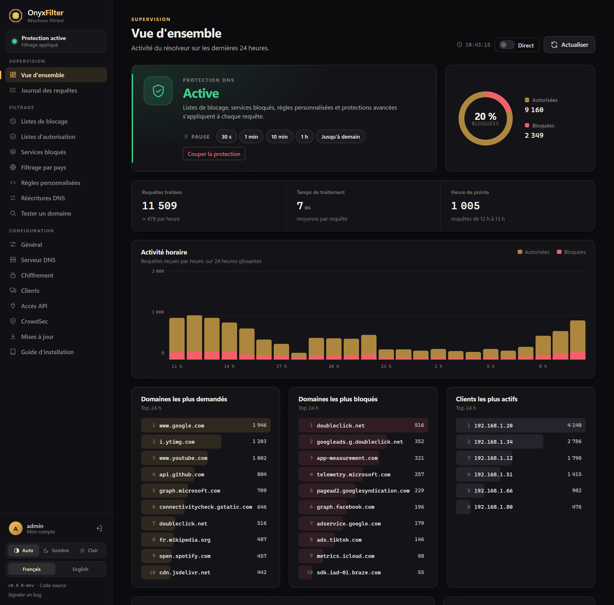
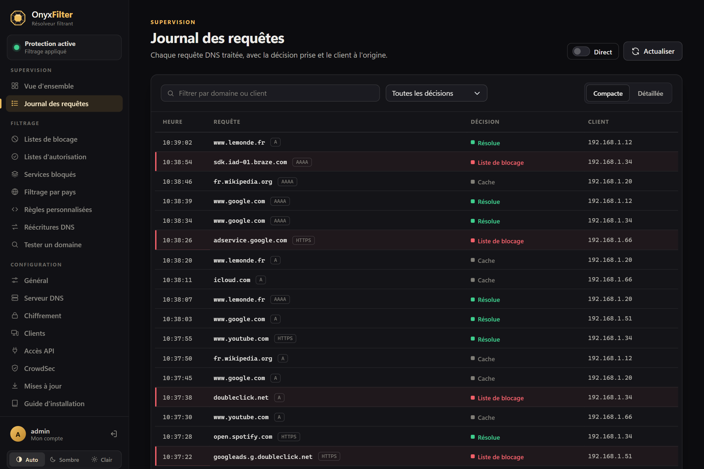
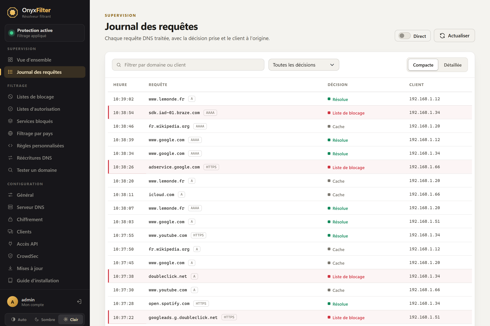
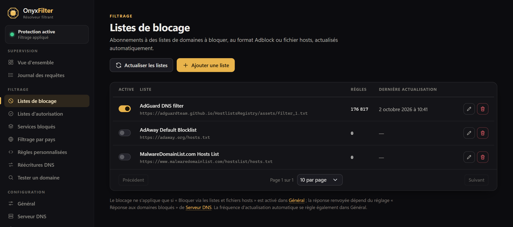
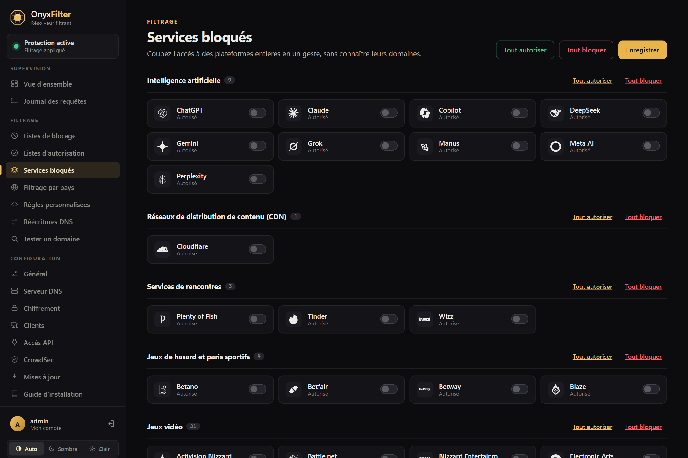
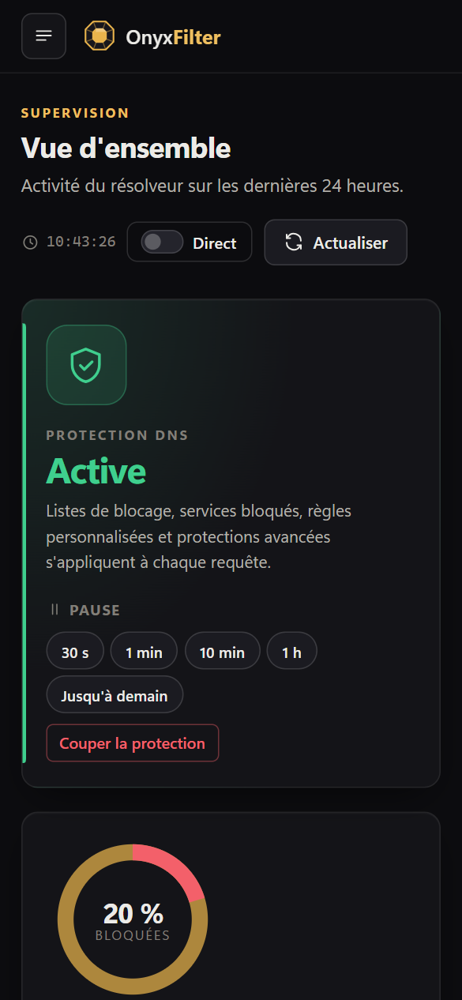

# OnyxFilter

*[Version française](README.md) · English version*

Self-hosted filtering DNS resolver: it blocks ads, trackers and unwanted domains for every device on the network, with
a web admin interface, an automation API and a CLI tool, all in a single binary.

Written in C# (.NET 10, ASP.NET Core Blazor), designed to run on a small machine (2 GB of RAM is enough).

## Screenshots



| Query log                                      | Light theme                                                       |
|------------------------------------------------|-------------------------------------------------------------------|
|    |  |
| **Blocklists**                                 | **Blocked services**                                              |
|  |         |

<p align="center"></p>

<sub>Screenshots taken on a demo instance (simulated traffic).</sub>

## Features

- **DNS server** over UDP/TCP (port 53), and encrypted DNS: DNS-over-HTTPS, DNS-over-TLS and DNS-over-QUIC (the latter
  requires the `libmsquic` package on Linux).
- **Filtering**: blocklists and allowlists (Adblock or hosts file format, automatically updated), custom rules
  (including regular expressions), DNS rewrites, one-click blocking of popular services with scheduled pause.
- **Protections**: safe browsing (malware, phishing), parental control, enforced safe search, globally or per client.
- **Upstream servers**: UDP, TCP, DNS-over-TLS and DNS-over-HTTPS, with load-balancing, parallel or fastest-response
  modes, fallback and bootstrap servers, caching and rate limiting.
- **Monitoring**: overview (hourly activity, blocking rate, rankings), filterable query log, temporary suspension of
  protection.
- **Administration**: web UI in French, English, German, Spanish and Italian (light and dark themes, mobile), sign-in
  with password or passkey, token-based HTTP API, CLI.
- **Updates**: one-click updates from the interface, based on GitHub releases.

## Installation (Linux x64)

Prerequisites: Linux x64 with systemd. The published build is self-contained (it bundles the .NET runtime): nothing
else to install.

```sh
curl -fsSL https://github.com/AnthoDingo/OnyxFilter/releases/latest/download/install.sh | sudo bash
```

The script downloads the latest release, verifies its SHA-256 checksum, installs it in `/opt/onyxfilter` under a
dedicated `onyxfilter` system account, and enables the `onyxfilter` service.
Options: `--version 1.4.0`, `--port 8080` (web UI), `--dir /opt/onyxfilter`. When run again on an existing
installation, it updates it while keeping data and settings.

### First start

The web UI is served at `http://<server-ip>:8080`. On first start, an `admin` account is created with a randomly
generated password, printed in the service log:

```sh
sudo journalctl -u onyxfilter | grep -A3 'Compte administrateur'
```

Then change it from **My account**, or from the command line (see below). If the password is lost or missing from the
log, set a new one with `sudo -u onyxfilter /opt/onyxfilter/OnyxFilter user:reset-password admin`. Finally, set the
server's IP address as the DNS server in your router's DHCP settings.

### Port 53 already in use

On many distributions, `systemd-resolved` already uses port 53. Disable its stub listener:

```sh
# /etc/systemd/resolved.conf
[Resolve]
DNSStubListener=no
```

then run `sudo systemctl restart systemd-resolved && sudo systemctl restart onyxfilter`.

### Docker

A multi-arch image (linux/amd64, linux/arm64: Raspberry Pi 3+ running a 64-bit OS) is published to
`ghcr.io/anthodingo/onyxfilter` with every release (`latest`, `1`, `1.4`, `1.4.0`…). The
[`docker-compose.yml`](docker-compose.yml) template exposes DNS (53) and the web UI (8080), and persists data in a
volume:

```sh
curl -fsSLO https://raw.githubusercontent.com/AnthoDingo/OnyxFilter/main/docker-compose.yml
docker compose up -d
docker compose logs onyxfilter | grep -A3 'Compte administrateur'
docker compose exec onyxfilter OnyxFilter user:reset-password admin   # administration
```

Without Compose: `docker run -d --name onyxfilter -p 53:53/udp -p 53:53/tcp -p 8080:8080 -v onyxfilter-data:/data
--restart unless-stopped ghcr.io/anthodingo/onyxfilter`.

- The container runs under an unprivileged account (UID 1654): a host directory mounted on `/data` must be owned by
  this account (`sudo chown -R 1654 ./data`).
- Ports 443, 853 and 784/udp (encrypted DNS) and 80 (Let's Encrypt) must be published depending on the enabled
  features.
- In "bridge" network mode, all clients appear with the Docker gateway's IP; use `network_mode: host` to see their
  real IPs.
- The built-in updater is disabled in containers; update with: `docker compose pull && docker compose up -d`.
- DNS-over-QUIC is not available in the image (msquic is not included).

#### Building the image locally

From the repository root (only Docker is required: the build runs inside the .NET SDK image):

```sh
git clone https://github.com/AnthoDingo/OnyxFilter.git && cd OnyxFilter
docker build -t onyxfilter .
docker build --build-arg VERSION=1.4.0 -t onyxfilter:1.4.0 .   # version number displayed by the application
```

The [`docker-compose.dev.yml`](docker-compose.dev.yml) template builds the image (`onyxfilter:dev`) from source, then
runs it with the same ports and the same volume as `docker-compose.yml`:

```sh
docker compose -f docker-compose.dev.yml up -d --build   # rebuilds after each change
docker compose -f docker-compose.dev.yml logs onyxfilter | grep -A3 'Compte administrateur'
```

For a multi-arch image (like the published one), use Buildx:
`docker buildx build --platform linux/amd64,linux/arm64 -t onyxfilter .` (add `--push` to push to a registry, or
`--load` for a single platform).

### Manual installation

1. Download `OnyxFilter-<version>-linux-x64.tar.gz` and `checksums.txt` from the
   [releases](https://github.com/AnthoDingo/OnyxFilter/releases), verify the archive
   (`sha256sum --check --ignore-missing checksums.txt`) and extract it to `/opt/onyxfilter`.
2. Install the provided service: `sudo cp /opt/onyxfilter/onyxfilter.service /etc/systemd/system/` (adjust `User`,
   `WorkingDirectory` and `ASPNETCORE_URLS` if needed), create the `onyxfilter` account and give it ownership of the
   directory.
3. `sudo systemctl daemon-reload && sudo systemctl enable --now onyxfilter`.

The service must keep `Restart=always`: this is what restarts OnyxFilter after an update is installed.

## Updates

OnyxFilter checks GitHub for new versions every 12 hours (can be disabled); a badge then appears in the menu. From
**Configuration › Updates**, a single click is enough:

1. download the linux-x64 archive and verify its SHA-256 checksum (`checksums.txt` required);
2. safely extract it, and check that the archive actually contains the announced version;
3. replace the application files; the replaced files are backed up to `/opt/onyxfilter/.update/backup/`. Data and
   settings (database, `appsettings*.json`, caches) are never modified;
4. OnyxFilter stops and systemd immediately restarts it on the new version (a few seconds of DNS downtime).

If something fails, the original installation is restored. To manually roll back to the previous version:

```sh
sudo systemctl stop onyxfilter
sudo cp -a /opt/onyxfilter/.update/backup/. /opt/onyxfilter/
sudo systemctl start onyxfilter
```

Built-in installation is only offered for a published self-contained linux-x64 build run by systemd, in a directory
writable by the service account. Elsewhere (local build, container, other platform), the new version is only
announced. Pre-releases (`v1.5.0-beta.1`…) can be offered by enabling the corresponding option.

The `Updates` section of `appsettings.json` lets you track another repository (`Repository`), a GitHub API-compatible
mirror (`ApiBaseUrl`), or allow installation under a supervisor other than systemd (`AssumeSupervised`).

## CLI

The same binary serves as both the server and the administration tool. Run without arguments, it prints usage help.

| Command                                                              | Description                                                         |
|----------------------------------------------------------------------|---------------------------------------------------------------------|
| `OnyxFilter --server [--urls …]`                                     | Starts the server (DNS, web UI, API).                               |
| `OnyxFilter status`                                                  | Installation summary: directories, database, protections, settings. |
| `OnyxFilter user:list`                                               | Lists accounts.                                                     |
| `OnyxFilter user:add <name> [password]`                              | Creates an account (prompts for the password if omitted).           |
| `OnyxFilter user:reset-password <name> [password]`                   | Resets a password (legacy form: `--reset`).                         |
| `OnyxFilter user:remove <name> [--yes]`                              | Deletes an account (never the last one).                            |
| `OnyxFilter rules:list` / `rules:add <rule>` / `rules:remove <rule>` | Custom filtering rules.                                             |
| `OnyxFilter lists:list`                                              | Blocklists and allowlists.                                          |
| `OnyxFilter update:check [--pre]`                                    | Checks for a new version.                                           |
| `OnyxFilter --version`                                               | Displays the version.                                               |

Commands operate on the data directory: the current directory if it contains data, otherwise the executable's
directory, or the one given by `--data-dir <directory>`. On an installed server, run them as the service account so
that modified files remain accessible to it, for example `sudo -u onyxfilter /opt/onyxfilter/OnyxFilter user:list`. A
running server does not reload settings changed from the command line: restart it
(`sudo systemctl restart onyxfilter`).

## HTTP API

The `/api/v1` API lets you automate OnyxFilter (home automation, scripts, monitoring). Create a token from
**Configuration › API Access**, then send it in the `Authorization: Bearer <token>` header (or `X-Api-Key`). The page
documents each endpoint and gives examples.

| Endpoint                          | Description                                                                          |
|-----------------------------------|--------------------------------------------------------------------------------------|
| `GET /api/v1/protection`          | Filtering status.                                                                    |
| `POST /api/v1/protection/disable` | Suspends filtering, `{"durationSeconds": 600}` or `{"until": "…"}` optional.         |
| `POST /api/v1/protection/enable`  | Re-enables filtering.                                                                |
| `GET /api/v1/stats`               | Usage statistics over the last 24 hours.                                             |
| `GET /api/v1/querylog`            | Query log (`limit`, `offset`, `search`, `reason`).                                   |
| `GET /api/v1/update`              | Update status.                                                                       |
| `POST /api/v1/update/check`       | Checks for a new version.                                                            |
| `POST /api/v1/update/install`     | Installs the new version, then restarts.                                             |
| `GET /api/v1/access`              | Client access to the DNS: mode and lists (allowed, denied, always allowed).          |
| `GET /api/v1/access/check?ip=…`   | Indicates whether an IP is served, and by which rule.                                |
| `GET /api/v1/access/me`           | Same response for the caller's IP, as seen by the server.                            |
| `POST /api/v1/access/block`       | Blocks an IP or a subnet, `{"client": "192.168.1.50"}`.                              |
| `POST /api/v1/access/allow`       | Allows an IP or a subnet (same format).                                              |

```sh
curl -X POST -H "Authorization: Bearer $ONYX_TOKEN" -H "Content-Type: application/json" \
     -d '{"durationSeconds": 600}' http://onyxfilter.lan:8080/api/v1/protection/disable
```

The `/access` endpoints edit the lists in **DNS settings › Access control**, taking effect immediately, without
changing the mode: without an allowed-clients list, blocking adds the client to the denied list; with such a list,
blocking removes it (never its last rule, which would open the DNS to everyone). A specific rule takes precedence over
a broader one: allowing `203.0.113.5` while `203.0.113.0/24` is denied adds it to the always-allowed clients, and only
that address is unblocked.

Outside your local network, only expose the API over HTTPS: the token is sent with every request.

## Configuration

- **Web UI**: listen address via `ASPNETCORE_URLS` (in the systemd service) or `--urls`.
- **UI settings**: saved in `appsettings.local.json`, next to the `OnyxFilter.db` database. These two files are
  essentially all you need to back up.
- **Default settings**: `appsettings.json` (connection string, initial blocklists, `Updates` section).

## Development

Prerequisites: [.NET 10 SDK](https://dotnet.microsoft.com/download).

```sh
cd src/OnyxFilter
dotnet run              # launch profile: adds --server, web UI on http://localhost:5259
dotnet run -- status    # any command
```

Port 53 requires root privileges (or `CAP_NET_BIND_SERVICE` on Linux). The code is organized as follows:

- `Components/`: Blazor interface (pages, layout, shared components);
- `Services/`: DNS engine, filtering, statistics, logs, API (`Services/Api`), updates (`Services/Updates`);
- `Cli/`: command-line commands;
- `deploy/`: systemd service, installation script and Docker image entrypoint;
- `Dockerfile`, `docker-compose.yml`, `docker-compose.dev.yml`: Docker image, deployment template and local build
  template;
- `.github/workflows/release.yml`: release publishing.

## Publishing a release

Push a tag in the `vMAJOR.MINOR.PATCH` format (or `v1.5.0-beta.1` for a pre-release):

```sh
git tag v1.4.0
git push origin v1.4.0
```

The "Publication" workflow compiles the self-contained linux-x64 build with this version number, creates
`OnyxFilter-1.4.0-linux-x64.tar.gz` and `checksums.txt`, and attaches them with `install.sh` to a GitHub release.
Existing installations then offer it on their **Updates** page. It then publishes the Docker image (amd64 and arm64)
to `ghcr.io/anthodingo/onyxfilter`; on the first release, make the package public from its settings on GitHub
(Packages › onyxfilter › Package settings) so that it can be pulled without authentication.

## Credits

- Catalog of blockable services taken from
  [AdguardTeam/HostlistsRegistry](https://github.com/AdguardTeam/HostlistsRegistry).
- Web UI built with [Bootstrap](https://getbootstrap.com/) (MIT license) and
  [Spectre.Console](https://spectreconsole.net/) for the CLI.
- QR codes generated with [QRCoder](https://github.com/codebude/QRCoder) (MIT license).
- Country flags: "Twemoji Country Flags" font
  ([country-flag-emoji-polyfill](https://github.com/talkjs/country-flag-emoji-polyfill), MIT), graphics
  [Twemoji](https://github.com/jdecked/twemoji) © Twitter, Inc. and contributors, CC-BY 4.0 license.
- Client countries and ISPs: [iptoasn.com](https://iptoasn.com) database (public domain, PDDL).
- Country map: borders from [Natural Earth](https://www.naturalearthdata.com/) (public domain).

## License

OnyxFilter is free software: you can redistribute it and/or modify it under the terms of
the [GNU Affero General Public License](LICENSE) as published by the Free Software Foundation, either version 3 of the
License, or (at your option) any later version (AGPL-3.0-or-later).

It is distributed in the hope that it will be useful, but without any warranty; without even the implied warranty
of merchantability or fitness for a particular purpose. See the [LICENSE](LICENSE) file for the full terms.

In short: you can use, study, change and share it freely. If you distribute a modified version, or let other people use
a modified version over a network, you must offer them its source code under the same license.
